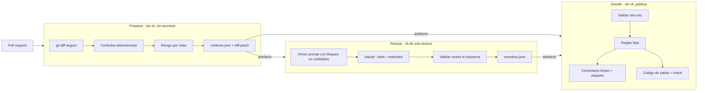

# Arquitectura

## Flujo

Las tres etapas son trabajos separados de GitHub Actions. Cada uno arranca en una máquina limpia, con sus propios permisos, y solo se pasan archivos (artefactos). Ningún trabajo comparte entorno, tokens ni procesos con otro.

## Las reglas de decisión

Se aplican en orden; la primera que se cumple decide:

1. Un control automático bloquea (test desactivado o enfocado, algo con forma de secreto) → **BLOQUEADO**.
2. La IA reporta un hallazgo crítico o dice `BLOQUEAR` → **BLOQUEADO**.
3. La IA dice `CAMBIOS` → **CAMBIOS SOLICITADOS**.
4. La IA no respondió → **REVISIÓN HUMANA** (o BLOQUEADO, según `si_falla_la_ia`).
5. Ruta de alto riesgo, intento de manipulación, tests eliminados, caracteres bidireccionales o de relleno, enlaces simbólicos, rutas del diff que no se pudieron leer, diff recortado, un veredicto de la IA distinto de `APROBAR` que la configuración no hace bloqueante, o un PR con cambios que la IA no revisó (fork, enlaces simbólicos) → **REVISIÓN HUMANA**.
6. Nada de lo anterior → **SIN OBJECIONES**.

Si una persona con rol permitido (`roles_que_anulan`) y distinta del autor del PR puso la etiqueta de anulación, un BLOQUEADO o CAMBIOS pasa a REVISIÓN HUMANA y el comentario lo registra. Si la puso el autor u otra persona sin ese rol, se ignora y el comentario lo dice.

Las reglas 1 y 5 no dependen del modelo. Por eso, aunque un PR logre engañar a la IA (regla 2 o 3), los tests desactivados se siguen bloqueando y los cambios en áreas críticas siguen llegando a una persona. Es el mismo diseño de la etapa 5 de la demo: "el juez puede caer; el diseño no depende de que no caiga".

## La IA como juez (LLM-as-Judge)

- **Rúbrica fija** de cuatro criterios con escala anclada: cumple la intención, integridad de los tests, seguridad y mantenibilidad.
- **Razonar antes de decidir.** En el esquema, `razonamiento` va primero y `veredicto` al final, como en G-Eval.
- **Salida estructurada.** Claude Code valida la respuesta contra `veredicto.schema.json` (`--json-schema`) y la reintenta si no cumple. El revisor la valida otra vez en cada etapa.
- **Contexto, no solo diff.** La IA puede abrir cualquier archivo del repositorio con Read, Grep y Glob para entender quién llama al código cambiado.
- **Separación de roles.** El modelo que revisa no es el que escribió el código y no tiene herramientas para cambiarlo.

## Archivos

| Archivo | Etapa | Responsabilidad |
| --- | --- | --- |
| `scripts/comun.py` | todas | Configuración, patrones, limpieza de texto, lectura de diff, validación de esquema |
| `scripts/preparar.py` | 1 | Diff, controles, riesgo, contexto |
| `scripts/revisar.py` | 2 | Prompt, ejecución de Claude Code, validación |
| `scripts/decidir.py` | 3 | Reglas, comentario, etiquetas, código de salida |
| `scripts/local.py` | — | Las tres etapas en tu máquina, sin publicar |
| `prompts/sistema.md` | 2 | Rol, método y criterio |
| `prompts/tarea.md` | 2 | Cómo se presenta cada PR |
| `esquema/veredicto.schema.json` | 2 y 3 | Forma obligatoria del veredicto |

## Opciones de Claude Code que usa la revisión

| Opción | Para qué |
| --- | --- |
| `--bare` | En CI: no cargar hooks, skills, plugins, MCP, memoria ni `CLAUDE.md` del checkout |
| `--safe-mode` | En local (en vez de `--bare`, que no admite la sesión de la suscripción): desactiva `CLAUDE.md`, hooks, skills, plugins y MCP de la rama revisada |
| `--restricted` | Quitar herramientas que ejecutan código y confinar la lectura a los directorios de trabajo |
| `--tools Read,Grep,Glob` | Solo herramientas de lectura |
| `--disallowedTools mcp__* Bash Edit Write …` | Doble cierre de lo anterior |
| `--strict-mcp-config` | Ningún servidor MCP |
| `--permission-mode dontAsk` y `--permission-prompts none` | Cualquier acción que pediría permiso se niega |
| `--settings` con reglas `deny` | Prohibido leer `.env`, llaves, `.git/`, etc. |
| `--json-schema` y `--output-format json` | Respuesta validada y metadatos de costo |
| `--max-turns`, `--max-budget-usd` | Límites de trabajo y gasto |
| `--no-session-persistence` | No guardar la sesión en disco |
| `--append-system-prompt-file` | Agregar el criterio del revisor sin quitar las instrucciones de seguridad propias de Claude Code |

Referencia: [CLI de Claude Code](https://code.claude.com/docs/en/cli-reference) y [modo no interactivo](https://code.claude.com/docs/en/headless).

## Por qué no usar `anthropics/claude-code-action` directamente

La acción oficial es la mejor opción para el uso interactivo (`@claude` en comentarios) y trae protecciones propias: verifica permisos de quien la dispara y restaura la configuración `.claude/` de la rama base. Para un revisor automático con decisión de merge, este diseño necesitaba algo distinto: separar la IA de la publicación en trabajos diferentes, validar el veredicto con un esquema propio y decidir con reglas fijas fuera del modelo. Por eso invoca el CLI directamente. Si prefieres la acción, puedes reemplazar el trabajo `revisar` y conservar `preparar` y `decidir`.
